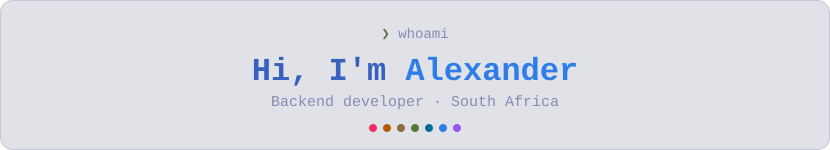
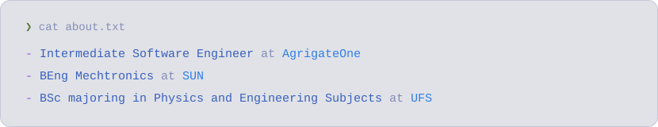
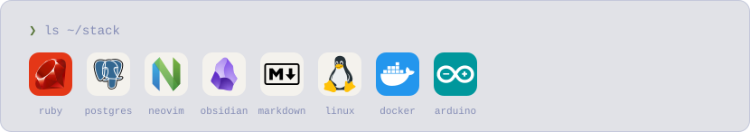

<!-- Panels are generated by assets/build.py — edit the content there, then run: python3 assets/build.py -->

  <picture>
    <source media="(prefers-color-scheme: dark)" srcset="/assets/header-dark.svg">
    
  </picture>

<!-- Badge colours: Tokyo Night palette (labelColor = accent, 24283b = background) -->

  
  
  
  
  
  <!--  -->

  <picture>
    <source media="(prefers-color-scheme: dark)" srcset="/assets/about-dark.svg">
    
  </picture>

  <picture>
    <source media="(prefers-color-scheme: dark)" srcset="/assets/stack-dark.svg">
    
  </picture>

  <picture>
    <source media="(prefers-color-scheme: dark)" srcset="/github-metrics-dark.svg">
    
  </picture>
  <picture>
    <source media="(prefers-color-scheme: dark)" srcset="/metrics.isocalendar-dark.svg">
    
  </picture>

